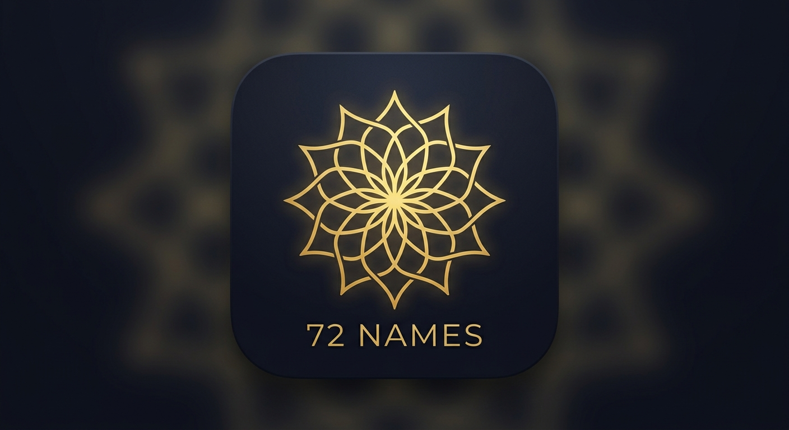

# ✧ 72 Luminous Names: Meditation & Manifestation

[](https://www.python.org/downloads/)
[](https://flask.palletsprojects.com/)
[](https://opensource.org/licenses/MIT)

> **Manifesting Divine Light through the Sacred Word.**

**72 Luminous Names** is a spiritual technology platform designed to facilitate deep meditation through the **72 Names of God**. Moving beyond the concept of "secret" occultism, this project focuses on the *manifestation* and *descent* of spiritual light into daily consciousness through the power of sound and frequency.



## ✨ The Vision

Based on the intersection of ancient Kabbalistic tradition and modern evolutionary spirituality, **72 Luminous Names** treats the names not as hidden mysteries, but as active **spiritual frequencies**. Each session is a vehicle for the "Solar" aspiration—the progressive self-revelation of light within the being.

## 🛠️ Key Features

- **☀️ Supramental Focus:** Designed for the manifestation of light, moving from the obscure to the openly radiant.
- **🛡️ Stateless & Lightweight:** Built with Flask with zero required runtime secrets or user accounts.
- **🎧 Pre-Generated Chants & Audio Pipeline:** Ships with all 72 `.mp3` chants in `static/audio/`, plus an optional Gemini TTS + `ffmpeg` script (`generate_audio.py`) for regenerating audio assets.
- **📖 Enhanced Catalog:** Includes traditional spiritual intentions (e.g., Healing, Miracle Making, Protection) for each name.
- **🚀 Deploy-Ready:** Optimized for Vercel with zero required runtime configuration.


## 🚀 Live Demo

Experience the platform live: **[72-luminous-names.vercel.app](https://72-luminous-names.vercel.app)**

## 🛠️ Quick Start

### 1. Prerequisites
Ensure you have Python 3.10+ installed. (`ffmpeg` and `GEMINI_API_KEY` are only needed if you want to regenerate the audio files.)

### 2. Installation
```bash
git clone https://github.com/fayerman-source/72-luminous-names.git
cd 72-luminous-names
python3 -m venv .venv
source .venv/bin/activate
pip install -r requirements.txt
```

### 3. Local Environment
No configuration required — the app is stateless and boots with no `.env`.

### 4. Regenerate Audio Assets (Optional)
All 72 `.mp3` chants are already included in `static/audio/`. To regenerate them via Gemini TTS (`gemini-3.1-flash-tts-preview`) and `ffmpeg`:
```bash
pip install -r requirements-audio.txt
export GEMINI_API_KEY="your-api-key"
python generate_audio.py
```

### 5. Launch
```bash
flask --app app run --debug
```
Visit `http://127.0.0.1:5000` to begin your session.

## 🧪 Testing
We maintain high standards for our core logic:
```bash
pip install -r requirements-dev.txt
pytest
```

## 🗺️ Roadmap
- [ ] High-fidelity studio recordings for all 72 sessions.
- [ ] Persistent user progress tracking.
- [ ] Advanced filtering by spiritual theme (e.g., Healing, Abundance, Protection).
- [ ] Mobile-first PWA enhancements.

## 🤝 Contributing
Contributions are welcome! Whether it's improving the meditation scripts, refining the UI, or adding new features, please feel free to open a PR.

## 📄 License
This project is licensed under the MIT License - see the [LICENSE](LICENSE) file for details.

---
*Created with intention for the global spiritual community.*
